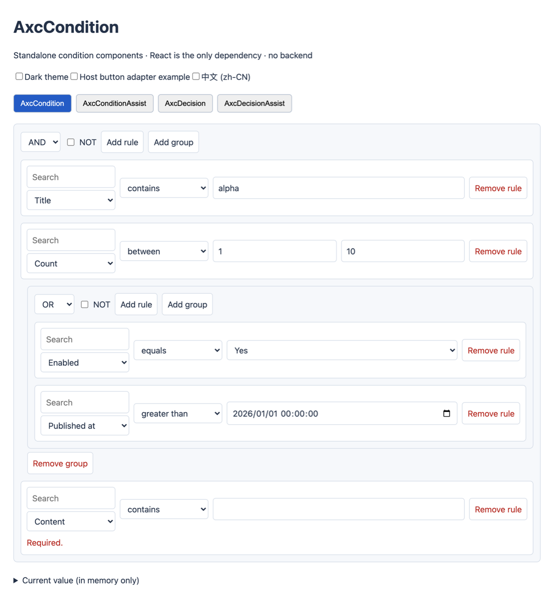
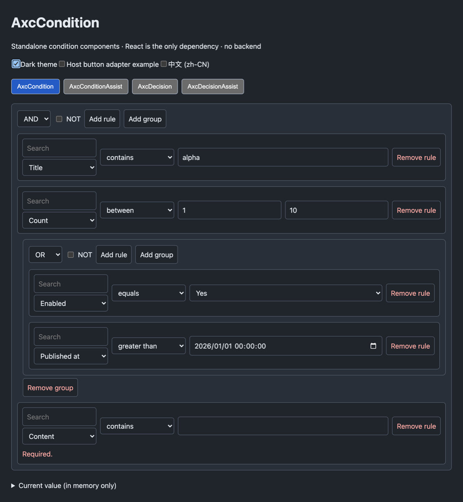
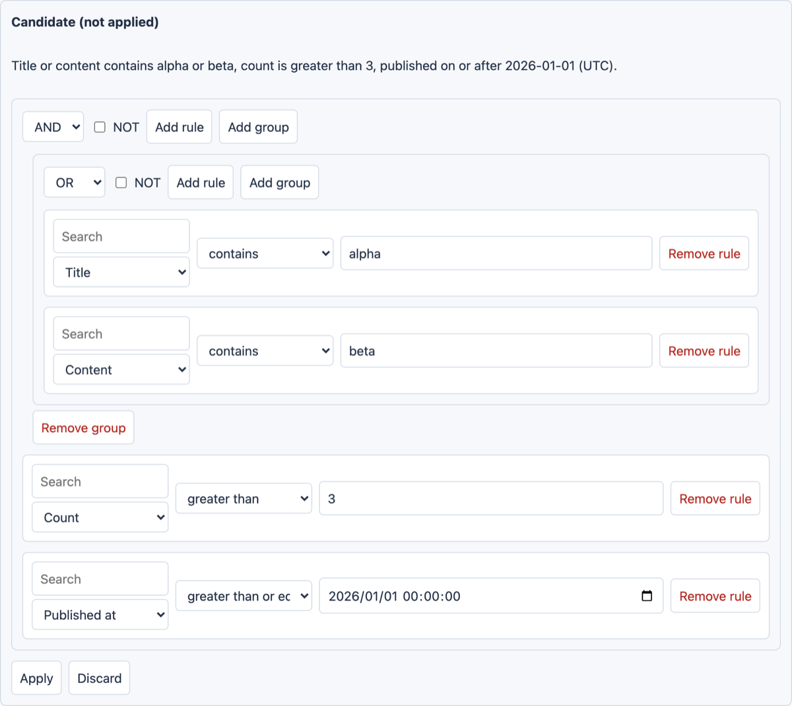
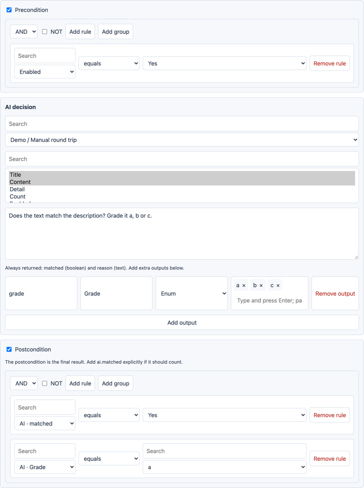
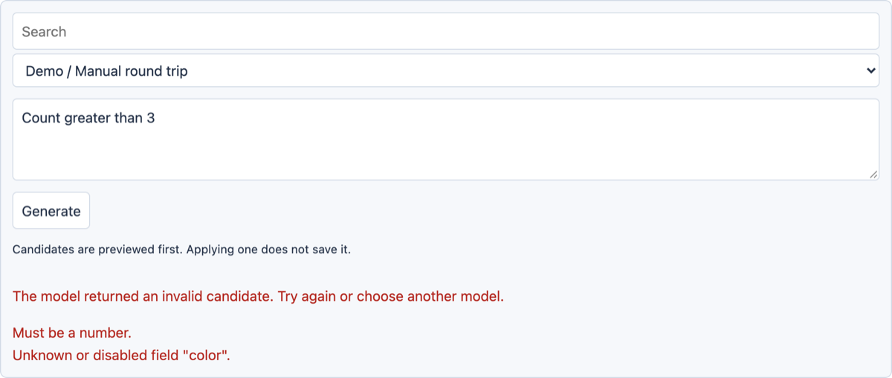

# Condition and decision builders

English | [简体中文](./README.zh-CN.md)

[AxcUIKit-TypeScript](../../README.md)

A lightweight **React query builder / condition builder / filter builder** for apps where users (or an LLM)
define AND/OR rules that you store as JSON and run on your own backend.

## The problems it solves

| Problem                                                                                                                                                                                 | What Axc does                                                                                                                                                                                                                                                 |
| --------------------------------------------------------------------------------------------------------------------------------------------------------------------------------------- | ------------------------------------------------------------------------------------------------------------------------------------------------------------------------------------------------------------------------------------------------------------- |
| **Saved filters break at runtime.** Builders happily emit `"1"` for a number field, empty groups, unknown fields or `2023-02-30`, and you find out when the backend evaluates the rule. | One parser (`parseCondition`) checks every rule against your field catalog: types are never coerced, dates must be real, datetimes need a time zone, ranges must be ordered, regexes must compile. Call it before saving.                                     |
| **"Generate a filter from a sentence" with an LLM is unreliable.** Models invent fields, return strings for numbers, wrap JSON in Markdown, or quietly approximate what was asked.      | Every request carries a JSON Schema built from your catalog (for structured output). The answer goes through the same parser, is shown as a preview with the model's explanation, and only **Apply** writes it back. Cancelled or stale requests are dropped. |
| **Errors are one string you cannot act on.** You get the first message, in one language, and cannot tell which row it belongs to.                                                       | Validation returns **every** issue as `{ code, path, params }`. The editor shows each one on its own row and marks the control invalid (`aria-invalid`). Your code branches on `code`; messages come from a locale.                                           |
| **The builder brings its own UI.** Its inputs and dropdowns do not match your design system, and replacing them means forking.                                                          | All eight basic controls (input, select, multi-select, checkbox, tags, date, textarea, button) go through a small adapter layer. Plug in Ant Design, MUI, shadcn/ui or your own; a tested Ant Design adapter is included.                                     |
| **Heavy dependencies and hard-coded language.**                                                                                                                                         | React 18/19 is the only dependency (≈19 KB gzip). English and Chinese are built in; every string and model prompt can be overridden.                                                                                                                          |
| **AI-based decisions are expensive and hard to combine with rules.** You want rules to pre-filter what reaches the model, and rules on the model's output afterwards.                   | `AxcDecision` edits a precondition → AI decision → postcondition plan. The precondition decides which records reach the model; the postcondition can read `ai.matched`, `ai.reason` and your own typed AI outputs.                                            |
| **A complex rule is hard to verify before saving.** A user needs to try one real record and see which condition determined the result or was skipped.                                   | `AxcConditionSimulator` sends the selected sample to `@axc/eval` and renders its decisive rules and exact short-circuit trace. UIKit never reimplements evaluation, stores evidence or hides evaluator errors.                                                |

Axc edits and validates. It does not implement rule evaluation, call models or store data. For browser simulation,
`AxcConditionSimulator` delegates to the `@axc/eval` function supplied by your app; production execution and persistence
remain host-owned. The framework-free protocol in `@axc/uikit/condition/core` is also usable in Node.js.

| Light                                                                                                                                | Dark                                                                                                                                                  |
| ------------------------------------------------------------------------------------------------------------------------------------ | ----------------------------------------------------------------------------------------------------------------------------------------------------- |
|  |  |

Errors are shown on the row they belong to ("Required." above). AI candidates are previewed before they are applied:



### When to use it

- You need users to build AND/OR filter rules (nested groups, typed fields, ranges, lists, field-to-field comparisons) and save them as JSON.
- You want an LLM to draft those rules from a sentence, with the output constrained by JSON Schema and validated before it is applied.
- You already have a UI library (Ant Design, MUI, shadcn/ui, Semi, …) and want the builder to use it.

### When not to use it

- You need SQL, MongoDB, CEL or JsonLogic export bundled into the editor, or an evaluator bundled into UIKit. The
  simulator requires the explicit `@axc/eval` function supplied by your application;
  [react-querybuilder](https://github.com/react-querybuilder/react-querybuilder) and
  [react-awesome-query-builder](https://github.com/ukrbublik/react-awesome-query-builder) ship formatters and more widgets.
- You want drag-and-drop rule reordering.

## Contents

- [Install](#install)
- [Quick start](#quick-start)
- [The five components](#the-five-components)
- [API reference](#api-reference)
- [Errors](#errors)
- [Internationalization](#internationalization)
- [UI adapters](#ui-adapters)
- [Condition protocol](#condition-protocol)
- [AI assist protocol](#ai-assist-protocol)
- [Runtime semantics: precondition → AI → postcondition](#runtime-semantics-precondition--ai--postcondition)
- [FAQ](#faq)
- [Development](#development)

## Install

```sh
npm install github:axclogo/AxcUIKit-TypeScript
```

Installs straight from the GitHub tag; npm builds `dist/` during install (`prepare`, about 20 s). Pin a tag for
reproducible installs. Imports are the same as for a registry package: `@axc/uikit/condition`, `@axc/uikit/condition/core`,
`@axc/uikit/condition/styles.css`.

Node.js 22.18+ is required for development. The runtime code targets ES2022.

## Quick start

```tsx
import { useState } from 'react';
import { AxcCondition, emptyCondition, parseCondition, type ConditionField } from '@axc/uikit/condition';
import '@axc/uikit/condition/styles.css';

const fields: ConditionField[] = [
	{ name: 'title', label: 'Title' },
	{ name: 'price', label: 'Price', dataType: 'number' },
];

export function Filter() {
	const [value, setValue] = useState(emptyCondition);
	return (
		<>
			<AxcCondition fields={fields} value={value} onChange={setValue} />
			<button type="button" onClick={() => save(parseCondition(value, { fields }))}>
				Save
			</button>
		</>
	);
}
```

`onChange` may emit unfinished drafts. The editor shows problems inline, and `parseCondition` throws
`AxcValidationError` until the value is valid. Always parse before saving.

## The five components

| Component               | Purpose                                                     | External work                                  |
| ----------------------- | ----------------------------------------------------------- | ---------------------------------------------- |
| `AxcCondition`          | Edit a condition tree                                       | None                                           |
| `AxcConditionAssist`    | Edit a condition tree with an AI assistant                  | Calls the host model on Generate               |
| `AxcConditionSimulator` | Run a selected sample and explain the exact execution trace | Calls the supplied `@axc/eval` function on Run |
| `AxcDecision`           | Edit a precondition → AI decision → postcondition plan      | None (your app runs the decision)              |
| `AxcDecisionAssist`     | Edit the whole decision plan with an assistant              | Calls the host model on Generate               |

### AxcCondition

```tsx
<AxcCondition fields={fields} value={value} onChange={setValue} maxLevels={3} allowNot={false} />
```

### AxcConditionAssist

```tsx
const assist: AxcAssistTransport = {
	models: [{ id: 'model-a', label: 'Model A', provider: 'Provider' }],
	// Call your model and resolve to the parsed JSON object it returned.
	generate: (request, signal) => myModelClient.json(request, { signal }),
};

<AxcConditionAssist fields={fields} value={value} onChange={setValue} assist={assist} />;
```

The candidate is previewed (and can be edited) first. Only **Apply** calls `onChange`.

### AxcConditionSimulator

Install `@axc/eval` from its versioned release asset, then pass its real WebAssembly export directly. UIKit has no
evaluator dependency, so apps that do not render the simulator do not load WASM.

```sh
npm install https://github.com/axclogo/AxcEval/releases/download/v0.3.0/axc-eval-0.3.0.tgz
```

```tsx
import { simulateCondition } from '@axc/eval';
import { AxcConditionSimulator } from '@axc/uikit/condition';

const [sampleId, setSampleId] = useState<string | null>('order-42');

<AxcConditionSimulator
	fields={fields}
	value={value}
	samples={[{ id: 'order-42', label: 'Order #42', record: order }]}
	selectedSampleId={sampleId}
	onSelectedSampleIdChange={setSampleId}
	simulate={simulateCondition}
	onEvidence={keepSnapshots ? saveSnapshot : undefined}
/>;
```

The result shows the final match, every decisive rule, negated groups, the short-circuit position and nodes that were
not evaluated. A result disappears as soon as its condition, catalog, executor or selected record changes, so stale
output is never presented as current. Invalid conditions and records remain evaluator errors; the component displays
the error and forwards its original value through `onError`. Evidence is opt-in and is never retained by UIKit.

### AxcDecision

```tsx
const [decision, setDecision] = useState(emptyDecision);

<AxcDecision fields={fields} value={decision} onChange={setDecision} models={runtimeModels} />;
```



`models` lists the models that may run the decision. `conditionAssist` optionally adds an assistant to the pre- and postcondition editors.

### AxcDecisionAssist

```tsx
<AxcDecisionAssist fields={fields} value={decision} onChange={setDecision} models={runtimeModels} assist={assist} />
```

The assistant generates the whole plan. The candidate is a read-only preview applied as one unit; the runtime `model` the user picked is kept.

## API reference

See the maintained [React interface](./api/index.api.md) and [core interface](./api/core.api.md) for all exports.

### Component props

The four editors take the catalog props plus `value`, `onChange`, `disabled` and `readOnly`. The simulator has a
separate controlled sample and execution contract.

| Prop              | Type                                     | Notes                                                                                           |
| ----------------- | ---------------------------------------- | ----------------------------------------------------------------------------------------------- |
| `fields`          | `ConditionField[]`                       | The fields users can filter on. Names must be unique.                                           |
| `maxLevels`       | `number` (default `5`)                   | Maximum group depth, including the root.                                                        |
| `allowNot`        | `boolean` (default `true`)               | `false` hides group negation and rejects `not: true` (editor, parser and schema).               |
| `value`           | `AxcConditionValue` / `AxcDecisionValue` | Controlled value. Update it immutably.                                                          |
| `onChange`        | `(value) => void`                        | Without it the editor is read-only.                                                             |
| `disabled`        | `boolean`                                | Keeps the layout, disables every control.                                                       |
| `readOnly`        | `boolean`                                | Disables every control and hides add/remove buttons and the assistant.                          |
| `allowEmpty`      | `boolean` (`AxcCondition*` only)         | Accept an empty root group. Nested groups are never empty. Assist candidates must be non-empty. |
| `assist`          | `AxcAssistTransport` (`*Assist` only)    | Model list and `generate` callback for the assistant.                                           |
| `models`          | `AxcModelOption[]` (`AxcDecision*`)      | Runtime models. May be empty. Axc only checks that `value.model` is in the list.                |
| `conditionAssist` | `AxcAssistTransport` (`AxcDecision*`)    | Optional assistant for the pre- and postcondition editors.                                      |

`AxcConditionSimulator` additionally takes `samples`, controlled `selectedSampleId` /
`onSelectedSampleIdChange`, and the `simulateCondition` function as `simulate`. Optional `onResult`, `onError` and
`onEvidence` callbacks expose the exact evaluator outputs. Sample ids must be non-empty and unique; ambiguous
configuration throws `TypeError` instead of choosing a record.

### `ConditionField`

```ts
type ConditionField = {
	name: string; // unique key, used verbatim (dots are not paths)
	label: string;
	dataType?: 'string' | 'number' | 'boolean' | 'date' | 'datetime' | 'enum' | 'array' | 'object'; // default 'string'
	description?: string;
	disabled?: boolean; // shown but not selectable; rules using it are invalid
	operators?: ConditionOperator[]; // replaces the built-in operators
	values?: ConditionOption[]; // only for 'string' | 'enum' | 'array'
	valueSources?: Array<'value' | 'field'>; // default ['value']
};
```

`values` holds string options, so it is only allowed on string-valued types. Declaring it on
`number`, `boolean`, `date`, `datetime` or `object` is a TypeScript error and a runtime `TypeError`.

### Core functions (`@axc/uikit/condition` and `@axc/uikit/condition/core`)

| Function                                                                | Purpose                                                                  |
| ----------------------------------------------------------------------- | ------------------------------------------------------------------------ |
| `emptyCondition()`                                                      | `{ combinator: 'and', not: false, rules: [] }`, a draft.                 |
| `validateCondition(value, catalog, { allowEmpty }?)`                    | Returns every `AxcIssue`; `[]` means valid.                              |
| `parseCondition(value, catalog, { allowEmpty }?)`                       | Returns `value` typed, or throws `AxcValidationError`.                   |
| `conditionSchema(catalog)`                                              | JSON Schema 2020-12 for model output. Still parse the result.            |
| `operatorsFor(field)`                                                   | The operators the editor, schema and parser use for a field.             |
| `conditionAssistRequest(model, requirement, current, catalog, locale?)` | Builds `{ model, prompt, response_schema }`.                             |
| `parseConditionResult(input, catalog)`                                  | Reads `{ explanation, value }` from a model. Throws on anything invalid. |
| `emptyDecision()`                                                       | An unfinished `AxcDecisionValue` with `model: null`.                     |
| `validateDecisionPlan(plan, catalog)` / `parseDecisionPlan`             | Same pattern for decision plans.                                         |
| `validateDecision(value, catalog, models)` / `parseDecision`            | Plan plus the runtime model, which must be in `models`.                  |
| `decisionPlan(value)`                                                   | Drops `model` from an `AxcDecisionValue`.                                |
| `decisionFields(outputs, locale?)`                                      | The `ai.*` fields the postcondition can use.                             |
| `decisionSchema(catalog)` / `decisionResultSchema(outputs)`             | Schemas for a plan and for the runtime model answer.                     |
| `decisionAssistRequest(...)` / `parseDecisionResult(...)`               | Assist request and reader for whole plans.                               |
| `decisionRequest(value, input, catalog, locale?)`                       | Runtime model request for one record.                                    |
| `parseDecisionOutput(input, outputs)`                                   | Reads the runtime model answer strictly.                                 |
| `formatIssue(issue, locale)` / `formatPath(path)`                       | Render an issue message / `$.rules[0].value`.                            |
| `en`, `zhCN`                                                            | Built-in locales.                                                        |

React-only exports: the five components, `AxcUIProvider`, `useAxcLocale` and the control prop types.

## Errors

Validators never stop at the first problem. Each issue has:

```ts
type AxcIssue = { code: AxcIssueCode; path: Array<string | number>; params?: object };
// e.g. { code: 'type', path: ['rules', 0, 'value'], params: { expected: 'number' } }
```

`parse*` functions and request builders throw `AxcValidationError` with an `issues` array. Its
`message` (`$.rules[0].value: type`) is for logs only. Branch on `code`, show `formatIssue(issue, locale)`.

| Code               | Params     | Meaning                                                                     |
| ------------------ | ---------- | --------------------------------------------------------------------------- |
| `type`             | `expected` | Wrong JSON type (`object`, `array`, `string`, `number`, `boolean`, `null`). |
| `unknownKey`       | `key`      | Property not in the protocol.                                               |
| `required`         |            | Missing value or blank text.                                                |
| `empty`            |            | Empty group or list.                                                        |
| `duplicate`        | `value`    | Repeated list item.                                                         |
| `combinator`       |            | Not `and` / `or`.                                                           |
| `tooDeep`          | `max`      | Deeper than `maxLevels`.                                                    |
| `negationDisabled` |            | `not: true` while `allowNot` is false.                                      |
| `unknownField`     | `field`    | Unknown or disabled field.                                                  |
| `unknownOperator`  | `operator` | Operator not offered for the field.                                         |
| `fieldRefInvalid`  |            | Field reference not allowed or target missing / of another type.            |
| `fieldRefRequired` |            | The field only accepts field references.                                    |
| `rangeLength`      |            | A range needs two values.                                                   |
| `rangeOrder`       |            | Lower bound greater than upper bound.                                       |
| `option`           | `value`    | Not an enabled option.                                                      |
| `date`             |            | Not a real `YYYY-MM-DD` date.                                               |
| `datetime`         |            | Not an ISO datetime with seconds and an offset.                             |
| `regex`            |            | Does not compile as a JavaScript `RegExp`.                                  |
| `outputName`       | `name`     | Invalid, reserved or duplicate AI output name.                              |
| `enumOptions`      |            | Enum outputs need options; other output types must have none.               |

Configuration mistakes (duplicate field names, `values` on a number field, `maxLevels: 0`, host fields named `ai.*`)
are programming errors and throw `TypeError`, also during render.

## Internationalization

English is the default. Switch or customize through the provider:

```tsx
import { AxcUIProvider, zhCN, en, type AxcLocale } from '@axc/uikit/condition';

<AxcUIProvider locale={zhCN}>…</AxcUIProvider>;

const custom: AxcLocale = {
	...en,
	ui: { ...en.ui, addRule: 'Add filter' },
	issues: { ...en.issues, required: () => 'Please fill this in' },
	prompts: { ...en.prompts, conditionAssist: (ctx) => myPrompt(ctx) },
};
```

A locale contains UI text, operator labels, issue messages and the three model prompts
(`conditionAssist`, `decisionAssist`, `decisionRun`). Core functions that build prompts take an
optional `locale` argument; the components pass the provider's locale. A custom operator's
`label` wins over the locale.

## UI adapters

> Full guide with every control, a checklist, a working Ant Design adapter and a prompt for AI assistants:
> [docs/ui-adapters.md](./docs/ui-adapters.md). The adapter guide and template are included in the package.

`AxcUIProvider` replaces basic controls for everything below it. Pass only the controls you want to
replace; the rest stay native. Nested providers inherit from outer ones.

```tsx
import { Select as LibSelect } from 'some-ui-lib';
import type { AxcSelectProps, AxcUIComponents } from '@axc/uikit/condition';

function Select(props: AxcSelectProps) {
	return (
		<LibSelect
			className={props.className}
			aria-label={props.label}
			disabled={props.disabled}
			value={props.value}
			options={props.options}
			showSearch={props.searchable}
			allowClear={false}
			onChange={(value: string) => props.onChange(value)}
		/>
	);
}
export const controls = { Select } satisfies Partial<AxcUIComponents>;

<AxcUIProvider components={controls}>…</AxcUIProvider>;
```

Define adapters at module level. A component created during render remounts every time and loses focus and drafts.

### Contract

Every control must:

- use `label` as its accessible name (for `Checkbox`, also as its visible text);
- put `className` on its root element (Axc uses it for layout);
- never call `onChange` / `onClick` while `disabled`;
- when `invalid` is set, mark the control invalid (`aria-invalid`) and set `aria-describedby` to `describedBy`;
- pass plain values to callbacks, never events.

There is no `readOnly` prop on controls: a read-only editor passes `disabled` and hides structural buttons.

| Control       | `value` → `onChange`  | Cleared value | Notes                                                                                                                                        |
| ------------- | --------------------- | ------------- | -------------------------------------------------------------------------------------------------------------------------------------------- |
| `Button`      | `onClick()`           |               | Must render a non-submit button (`type="button"`). `label` is the accessible name if set. `tone="danger"` for removals.                      |
| `Input`       | `string → string`     | `''`          | `type` is `text` or `number`; numbers stay string drafts. Axc parses them strictly.                                                          |
| `TextArea`    | `string → string`     | `''`          |                                                                                                                                              |
| `Select`      | `string → string`     | n/a           | Emit only enabled option values. No clear button; Axc adds an explicit `''` option where "none" is allowed.                                  |
| `MultiSelect` | `string[] → string[]` | `[]`          | Emit only enabled option values.                                                                                                             |
| `Checkbox`    | `boolean → boolean`   |               |                                                                                                                                              |
| `Tags`        | `string[] → string[]` | `[]`          | Enter commits (not during IME composition); multi-line paste adds one item per line; never split on spaces or commas; do not commit on blur. |
| `DateInput`   | `string → string`     | `''`          | `kind="date"`: `YYYY-MM-DD`. `kind="datetime"`: local `YYYY-MM-DDTHH:mm:ss`. Axc converts to UTC ISO.                                        |

The package's boundary check (`npm run check`) fails the build if any code outside `src/ui` renders a
native control, if a native `<button>` lacks `type="button"`, or if UI text is hard-coded.

### Styling

Default controls use `.axc-native-control`; injected controls never get Axc's control styles.
Layout classes: `.axc-group`, `.axc-rule`, `.axc-toolbar`, `.axc-panel`, `.axc-candidate`, `.axc-error`.
Variables: `--axc-bg`, `--axc-panel`, `--axc-text`, `--axc-border`, `--axc-accent`, `--axc-danger`,
`--axc-gap`, `--axc-panel-padding`, `--axc-panel-radius`, `--axc-radius`, `--axc-control-padding`.
Set `data-axc-theme="dark"` on a container for the dark palette.

## Condition protocol

```json
{
	"combinator": "or",
	"not": false,
	"rules": [
		{ "field": "title", "operator": "contains", "value": "alpha" },
		{ "field": "price", "operator": "between", "value": [10, 20] },
		{ "combinator": "and", "not": true, "rules": [{ "field": "status", "operator": "null", "value": null }] }
	]
}
```

- Groups have exactly `combinator`, `not` and `rules`. Rules have `field`, `operator`, `value` and optionally `valueSource: "field"`. Nothing else, and no node IDs.
- Values keep their type: numbers are numbers, booleans are booleans, everything else is a string. Nothing is coerced.
- Operator shapes: `none` → `null`; `scalar` → one value; `list` → non-empty, unique array; `range` → `[from, to]` with `from ≤ to`.
- `date` is `YYYY-MM-DD`. `datetime` is ISO with seconds and `Z` or `±HH:mm`. The editor shows local time and stores UTC.
- `array` fields with `values` are option sets (`hasAny`, `hasAll`, `hasNone`); without `values` they are text lists (`contains`, `doesNotContain`).
- `object` fields are edited as plain text.
- A rule may compare with another field only if the field's `valueSources` includes `'field'`; the target must be enabled and of the same `dataType`.
- Custom operators declare `name`, `valueShape` and optionally `label`. Axc validates the shape; you implement the semantics.

| `dataType`         | Built-in operators                                                                                            |
| ------------------ | ------------------------------------------------------------------------------------------------------------- |
| `string`, `object` | `=` `!=` `contains` `doesNotContain` `beginsWith` `endsWith` `regex` `notRegex` `in` `notIn` `null` `notNull` |
| `number`           | `=` `!=` `>` `>=` `<` `<=` `between` `notBetween` `isZero` `isNotZero` `null` `notNull`                       |
| `date`, `datetime` | `=` `!=` `>` `>=` `<` `<=` `between` `notBetween` `null` `notNull`                                            |
| `boolean`          | `=` `!=` `null` `notNull`                                                                                     |
| `enum`             | `=` `!=` `in` `notIn` `null` `notNull`                                                                        |
| `array` + `values` | `hasAny` `hasAll` `hasNone` `null` `notNull`                                                                  |
| `array`            | `contains` `doesNotContain` `null` `notNull`                                                                  |

`conditionSchema(catalog)` is generated from the same operator table as the parser. It cannot express
range order, regex syntax, calendar validity or datetime offsets, so schema-valid output must still go through `parseCondition`.

## AI assist protocol

```ts
interface AxcAssistTransport {
	models: AxcModelOption[]; // { id, label, provider? }; ids are opaque to Axc
	generate(request: AxcAssistRequest, signal: AbortSignal): Promise<unknown>;
}
interface AxcAssistRequest {
	model: string;
	prompt: string;
	response_schema: object; // JSON Schema of { explanation: string, value: … }
}
```

- `generate` must resolve to parsed JSON, not text and not an HTTP envelope. Axc does not strip Markdown fences, unwrap strings, fix fields or retry.
- An invalid answer shows its issues and cannot be applied:

  

- A rejected promise shows your error message.
- **Cancel**, a change to the edited value, disabling the editor, or unmounting aborts `signal` and ignores the late result. Whether the provider stops (and stops billing) is up to you.
- If you switch between records, give the component a `key` per record so drafts do not carry over.

## Runtime semantics: precondition → AI → postcondition

```ts
const decision: AxcDecisionValue = {
	model: 'runtime-model',
	precondition: { combinator: 'and', not: false, rules: [{ field: 'enabled', operator: '=', value: true }] },
	input_fields: ['title', 'body'],
	instruction: 'Does the text match the description?',
	outputs: [{ name: 'category', label: 'Category', type: 'enum', options: ['a', 'b'] }],
	postcondition: { combinator: 'and', not: false, rules: [{ field: 'ai.matched', operator: '=', value: true }] },
};
```

Your app runs each record in this order:

1. **Precondition.** `null` means every record continues. Otherwise evaluate it; a record that does not match is final "no match" and the model is not called.
2. **AI decision.** `decisionRequest(decision, record, catalog, locale?)` sends only `input_fields`. Call the model, then pass its parsed JSON to `parseDecisionOutput(json, decision.outputs)`. The answer always has `matched: boolean` and `reason: string`, plus every declared output, and nothing else.
3. **Postcondition.** `null` means the result is `matched`. Otherwise the postcondition _is_ the result; it can read the original fields and `ai.matched`, `ai.reason`, `ai.<output>`. Include `ai.matched` explicitly if it should count.

A failed model call or an invalid answer is a failure, not "no match". Turning a pre/postcondition off sets it to `null` and discards its draft.

## FAQ

**Why must I call `parseCondition` myself?** The editor needs to hold drafts (a rule without a value yet). Saving is your decision, so validation is explicit.

**Is `regex` safe?** Axc only checks that the pattern compiles as a JavaScript `RegExp`. It cannot detect catastrophic backtracking (ReDoS). If you evaluate user-supplied patterns on a server, use a linear-time engine (for example RE2), a timeout, or disable the regex operators via `field.operators`.

**Why does the protocol have no node IDs?** IDs would leak editor state into stored data and model prompts. The editor keeps stable React keys internally, so deleting a row never hands its state to a neighbour.

**What happened to the "multi-word" mode?** It merged same-field `contains` rules implicitly and could not be controlled by the host. To enter many words at once, declare an explicit list operator, e.g. `operators: [{ name: 'containsAny', valueShape: 'list', label: 'contains any of' }]`, and implement it in your evaluator.

**Does it work with server rendering?** Yes. Components render without browser APIs; the assistant only runs in event handlers.

**Can I use it without React?** Use `@axc/uikit/condition/core`: types, validation, schemas, prompts and locales with no dependencies.

**Which React versions are supported?** 18.3 and 19. CI runs the whole test suite on both.

## Development

```sh
npm ci            # also builds dist/ via `prepare`
npm run verify    # everything CI runs; see AGENTS.md for each rule and its check
npm run check     # TypeScript + boundary rules + ESLint + knip
npm run api       # update the Condition interface reference in packages/condition/api/ after an intended API change
npm test          # all tests on React 19, then React 18
npm run build     # dist/: ESM, CSS and .d.ts
npm run format    # Prettier
npm run dev       # demo at http://127.0.0.1:5178
npm run demo:build # build once; then open packages/condition/demo/index.html directly
```

```text
src/core/         protocol: types, operators, validation, schemas, prompts, locales (no dependencies)
src/ui/           control contracts, provider, native controls (the only place native controls live)
src/internal/     editor helpers shared by the components
src/components/   the five public components
tests/            node:test + Testing Library + happy-dom; the root tests/react18 holds the React 18 runtime
```

License: MIT.

### Model picker adapter

`AxcUIProvider` accepts an optional `components.ModelSelect` with original model ids, labels and providers. Plug in a host cascading picker without changing stored rules or model request ids. See the [adapter contract](docs/ui-adapters.md#model-control).
