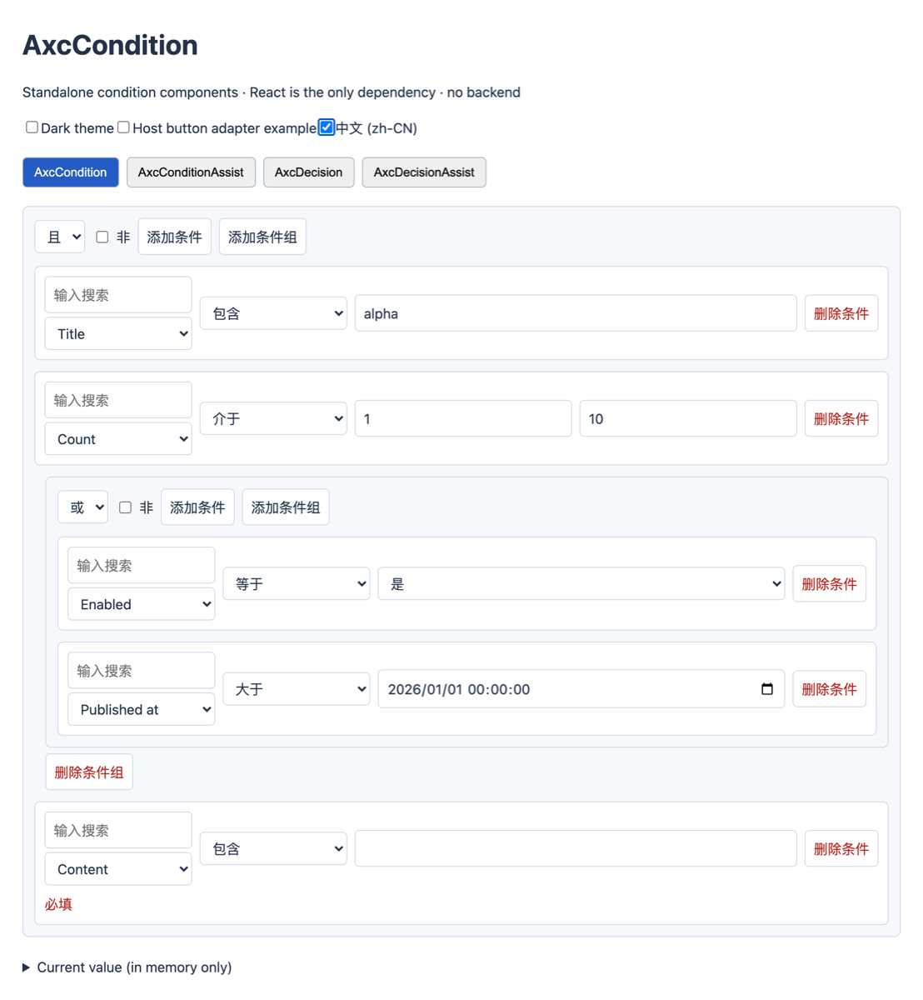
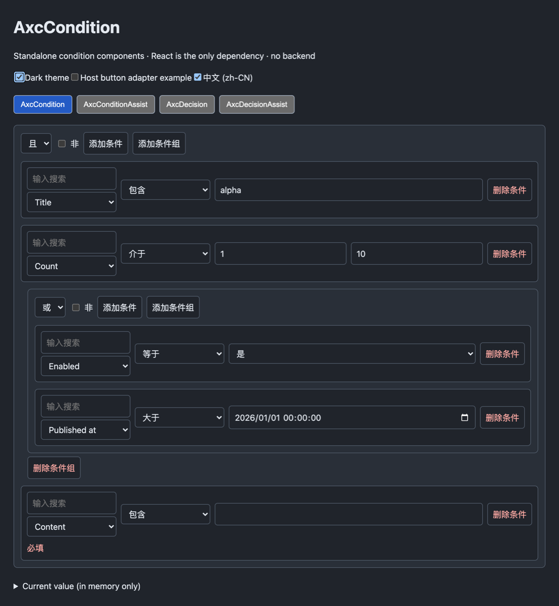
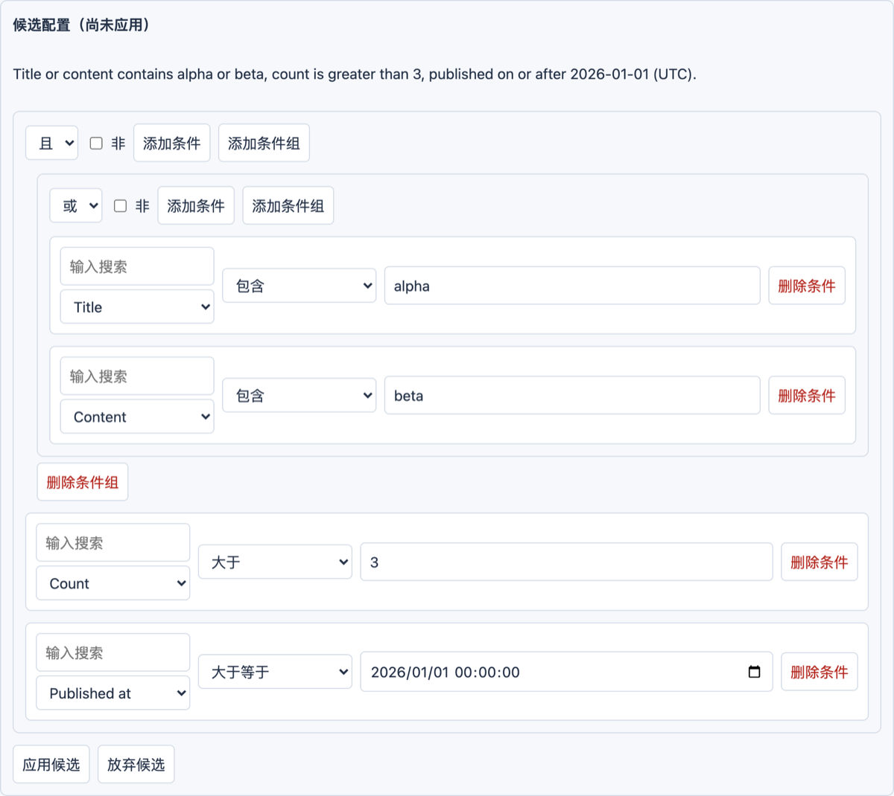
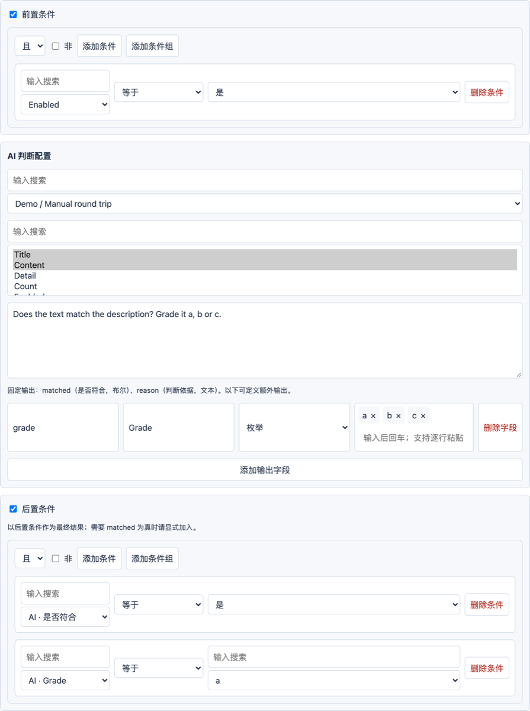
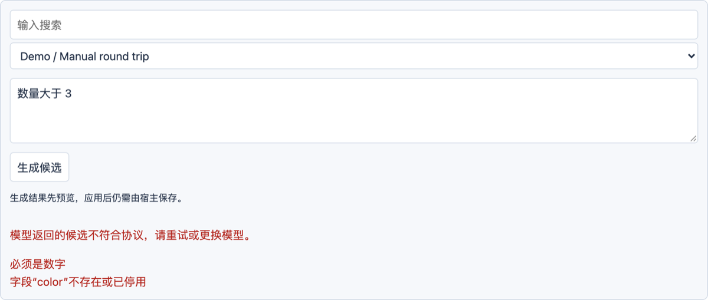

# 条件与判断规则编辑器

[English](./README.md) | 简体中文

[AxcUIKit-TypeScript](../../README.zh-CN.md)

轻量的 **React 条件构建器 / 查询构建器 / 筛选器（query builder / filter builder）**，适用于这样的应用：
由用户（或大模型）定义 AND/OR 规则，以 JSON 保存，在你自己的后端执行。

## 解决的问题

| 痛点                                                                                                                                 | Axc 的做法                                                                                                                                                                         |
| ------------------------------------------------------------------------------------------------------------------------------------ | ---------------------------------------------------------------------------------------------------------------------------------------------------------------------------------- |
| **保存的筛选条件到运行时才出错。** 构建器会给数字字段存 `"1"`、留下空组、引用不存在的字段、写出 `2023-02-30`，直到后端执行时才发现。 | 同一个解析器（`parseCondition`）按字段目录校验每条规则：不做类型猜测，日期必须真实存在，时间必须带时区，范围必须有序，正则必须能编译。保存前调用即可。                             |
| **用大模型“一句话生成筛选条件”不可靠。** 模型会编造字段、把数字写成字符串、用 Markdown 包裹 JSON，或用近似条件冒充原需求。           | 每次请求都附带按字段目录生成的 JSON Schema（用于结构化输出）。返回结果经过同一个解析器，连同模型的解释先预览，只有点“应用”才写回；取消或过期的请求会被丢弃。                       |
| **错误只是一段没法处理的文字。** 只能拿到第一条、只有一种语言，也不知道属于哪一行。                                                  | 校验返回**全部**问题，每条都是 `{ code, path, params }`。编辑器把错误显示在对应的行上，并把控件标为无效（`aria-invalid`）。代码按 `code` 判断，文案由语言包提供。                  |
| **构建器自带一套 UI。** 输入框和下拉与你的设计系统不一致，想替换只能 fork。                                                          | 8 个基础控件（输入框、单选、多选、复选框、标签、日期、多行文本、按钮）都经过一层很薄的适配层。可接入 Ant Design、MUI、shadcn/ui 或自研组件，并附带一份实测可用的 Ant Design 适配。 |
| **入口依赖重、文案写死。**                                                                                                           | Condition 入口只使用共享的 React peer（≤22 KB gzip）。内置中英文，所有文案和模型提示词都可覆盖。                                                                                   |
| **AI 判断成本高，又难和规则配合。** 希望先用规则筛掉不需要送给模型的数据，再对模型的输出套规则。                                     | `AxcDecision` 编辑“前置条件 → AI 判断 → 后置条件”方案：前置条件决定哪些记录交给模型；后置条件可以读取 `ai.matched`、`ai.reason` 和你定义的带类型 AI 输出。                         |
| **复杂条件保存前难以验证。** 用户需要选择一条真实数据，确认最终结果由哪个条件决定、哪些条件因短路没有执行。                          | `AxcConditionSimulator` 把所选数据交给 `@axclogo/eval`，展示决定性条件及完整短路轨迹。UIKit 不重复实现求值、不保存证据，也不隐藏执行器错误。                                       |

Axc 负责编辑和校验，不自行实现规则执行、调用模型或存储数据。浏览器模拟由 `AxcConditionSimulator` 调用应用传入的
`@axclogo/eval`；生产执行和持久化仍由宿主负责。零依赖协议层位于 `@axclogo/uikit/condition/core`，也可在 Node.js 中使用。

| 浅色                                                                                                                                 | 深色                                                                                                                                              |
| ------------------------------------------------------------------------------------------------------------------------------------ | ------------------------------------------------------------------------------------------------------------------------------------------------- |
|  |  |

错误显示在所属的行上（如上图的“必填”）。AI 候选先预览，再决定是否应用：



### 适合的场景

- 需要让用户搭建 AND/OR 筛选规则（嵌套组、带类型的字段、范围、列表、字段间比较），并以 JSON 保存。
- 希望让大模型根据一句话生成规则，输出受 JSON Schema 约束，并在应用前完成校验。
- 已经在用某个 UI 库（Ant Design、MUI、shadcn/ui、Semi 等），希望构建器沿用它的控件。

### 不适合的场景

- 需要编辑器直接内置 SQL、MongoDB、CEL、JsonLogic 导出，或把执行器捆绑进 UIKit。模拟组件要求应用显式传入
  `@axclogo/eval` 函数；
  [react-querybuilder](https://github.com/react-querybuilder/react-querybuilder) 和
  [react-awesome-query-builder](https://github.com/ukrbublik/react-awesome-query-builder) 提供格式化导出和更多控件。
- 需要拖拽调整规则顺序。

## 目录

- [安装](#安装)
- [快速上手](#快速上手)
- [五个组件](#五个组件)
- [API 参考](#api-参考)
- [错误](#错误)
- [国际化](#国际化)
- [UI 适配](#ui-适配)
- [条件协议](#条件协议)
- [AI 辅助协议](#ai-辅助协议)
- [运行语义：前置 → AI → 后置](#运行语义前置--ai--后置)
- [常见问题](#常见问题)
- [开发](#开发)

## 安装

```sh
npm install @axclogo/uikit
```

React 和 React DOM 是 peer dependency。React 组件从 `@axclogo/uikit/condition` 导入，无 React 的解析器从
`@axclogo/uikit/condition/core` 导入，样式从 `@axclogo/uikit/condition/styles.css` 导入。包不提供根入口。
需要控制升级时请固定精确 npm 版本。

安装和开发需要 Node.js 22.18+。浏览器运行时代码目标为 ES2022。

## 快速上手

```tsx
import { useState } from 'react';
import { AxcCondition, emptyCondition, parseCondition, type ConditionField } from '@axclogo/uikit/condition';
import '@axclogo/uikit/condition/styles.css';

const fields: ConditionField[] = [
	{ name: 'title', label: 'Title' },
	{ name: 'price', label: 'Price', dataType: 'number' },
];

export function Filter() {
	const [value, setValue] = useState(emptyCondition);
	return (
		<>
			<AxcCondition fields={fields} value={value} onChange={setValue} />
			<button type="button" onClick={() => save(parseCondition(value, { fields }))}>
				Save
			</button>
		</>
	);
}
```

`onChange` 可能给出未完成的草稿。编辑器会就地显示问题；值合法之前 `parseCondition` 会抛出
`AxcValidationError`。保存前务必先解析。

## 五个组件

| 组件                    | 用途                                    | 外部工作                                  |
| ----------------------- | --------------------------------------- | ----------------------------------------- |
| `AxcCondition`          | 编辑条件树                              | 无                                        |
| `AxcConditionAssist`    | 通过 AI 辅助编辑条件树                  | 点击生成时调用宿主模型                    |
| `AxcConditionSimulator` | 选择一条数据并展示真实执行轨迹          | 点击模拟时调用传入的 `@axclogo/eval` 函数 |
| `AxcDecision`           | 编辑“前置条件 → AI 判断 → 后置条件”方案 | 无（由应用执行判断）                      |
| `AxcDecisionAssist`     | 通过 AI 辅助编辑整套判断方案            | 点击生成时调用宿主模型                    |

### AxcCondition

```tsx
<AxcCondition fields={fields} value={value} onChange={setValue} maxLevels={3} allowNot={false} />
```

### AxcConditionAssist

```tsx
const assist: AxcAssistTransport = {
	models: [{ id: 'model-a', label: 'Model A', provider: 'Provider' }],
	// 调用你的模型，返回模型给出的、已解析的 JSON 对象。
	generate: (request, signal) => myModelClient.json(request, { signal }),
};

<AxcConditionAssist fields={fields} value={value} onChange={setValue} assist={assist} />;
```

候选先预览（可继续编辑），只有点击“应用”才会调用 `onChange`。

### AxcConditionSimulator

从 npm 安装官方 `@axclogo/eval` 包，将其真实 WebAssembly 导出函数直接传入。UIKit 本身不依赖执行器，未使用
模拟组件的应用不会加载 WASM。

```sh
npm install @axclogo/eval
```

```tsx
import { simulateCondition } from '@axclogo/eval';
import { AxcConditionSimulator } from '@axclogo/uikit/condition';

const [sampleId, setSampleId] = useState<string | null>('order-42');

<AxcConditionSimulator
	fields={fields}
	value={value}
	samples={[{ id: 'order-42', label: '订单 #42', record: order }]}
	selectedSampleId={sampleId}
	onSelectedSampleIdChange={setSampleId}
	simulate={simulateCondition}
	onEvidence={keepSnapshots ? saveSnapshot : undefined}
/>;
```

结果包含最终是否通过、决定结果的条件、取反组、短路位置及未执行节点。条件、字段目录、执行器或所选数据
发生变化后，旧结果立即隐藏，不会冒充当前结果。条件或数据不合法时保持为 Eval 错误：组件显示错误，并通过
`onError` 原样传出。证据回调为可选项，UIKit 不保留快照。

### AxcDecision

```tsx
const [decision, setDecision] = useState(emptyDecision);

<AxcDecision fields={fields} value={decision} onChange={setDecision} models={runtimeModels} />;
```



`models` 是可以执行判断的运行模型。`conditionAssist` 可为前置、后置条件编辑器加上 AI 辅助。

### AxcDecisionAssist

```tsx
<AxcDecisionAssist fields={fields} value={decision} onChange={setDecision} models={runtimeModels} assist={assist} />
```

辅助生成整套方案。候选只读预览、整体应用，并保留用户已选的运行模型 `model`。

## API 参考

全部导出见 [React 接口参考](./api/index.api.md)和[核心接口参考](./api/core.api.md)。

### 组件属性

四个编辑组件都接受目录属性，以及 `value`、`onChange`、`disabled`、`readOnly`。模拟组件使用独立的受控
数据选择与执行契约。

| 属性              | 类型                                     | 说明                                                                         |
| ----------------- | ---------------------------------------- | ---------------------------------------------------------------------------- |
| `fields`          | `ConditionField[]`                       | 可筛选的字段。name 必须唯一。                                                |
| `maxLevels`       | `number`（默认 `5`）                     | 最大组层数，包含根组。                                                       |
| `allowNot`        | `boolean`（默认 `true`）                 | 为 `false` 时隐藏组取反，并拒绝 `not: true`（编辑器、parser、Schema 一致）。 |
| `value`           | `AxcConditionValue` / `AxcDecisionValue` | 受控值，请不可变地更新。                                                     |
| `onChange`        | `(value) => void`                        | 不传则编辑器只读。                                                           |
| `disabled`        | `boolean`                                | 保留布局，禁用所有控件。                                                     |
| `readOnly`        | `boolean`                                | 禁用所有控件，并隐藏增删按钮和辅助入口。                                     |
| `allowEmpty`      | `boolean`（仅 `AxcCondition*`）          | 允许空根组；子组始终不能为空；AI 候选始终必须非空。                          |
| `assist`          | `AxcAssistTransport`（仅 `*Assist`）     | 辅助模型目录和 `generate` 回调。                                             |
| `models`          | `AxcModelOption[]`（`AxcDecision*`）     | 运行模型，可为空数组。Axc 只检查 `value.model` 在列表中。                    |
| `conditionAssist` | `AxcAssistTransport`（`AxcDecision*`）   | 可选：前置、后置条件编辑器的辅助。                                           |

`AxcConditionSimulator` 另外接收 `samples`、受控的 `selectedSampleId` /
`onSelectedSampleIdChange`，并通过 `simulate` 接收 `simulateCondition`。可选的 `onResult`、`onError`、
`onEvidence` 会原样传出执行器结果。样本 id 必须非空且唯一；配置有歧义时抛 `TypeError`，不会猜选某条数据。

### `ConditionField`

```ts
type ConditionField = {
	name: string; // 唯一键，按原样使用（点号不是路径）
	label: string;
	dataType?: 'string' | 'number' | 'boolean' | 'date' | 'datetime' | 'enum' | 'array' | 'object'; // 默认 'string'
	description?: string;
	disabled?: boolean; // 显示但不可选；使用它的规则无效
	operators?: ConditionOperator[]; // 替换内置操作符
	values?: ConditionOption[]; // 仅限 'string' | 'enum' | 'array'
	valueSources?: Array<'value' | 'field'>; // 默认 ['value']
};
```

`values` 的选项值是字符串，所以只能用于字符串类型。在 `number`、`boolean`、`date`、`datetime`
或 `object` 上声明会产生 TypeScript 类型错误，运行时抛 `TypeError`。

### 核心函数（`@axclogo/uikit/condition` 与 `@axclogo/uikit/condition/core`）

| 函数                                                                    | 用途                                                        |
| ----------------------------------------------------------------------- | ----------------------------------------------------------- |
| `emptyCondition()`                                                      | `{ combinator: 'and', not: false, rules: [] }`，草稿。      |
| `validateCondition(value, catalog, { allowEmpty }?)`                    | 返回全部 `AxcIssue`；`[]` 表示合法。                        |
| `parseCondition(value, catalog, { allowEmpty }?)`                       | 合法时原样返回（带类型），否则抛 `AxcValidationError`。     |
| `conditionSchema(catalog)`                                              | 供模型输出使用的 JSON Schema 2020-12；结果仍需 parse。      |
| `operatorsFor(field)`                                                   | 编辑器、Schema、parser 共用的字段操作符。                   |
| `conditionAssistRequest(model, requirement, current, catalog, locale?)` | 生成 `{ model, prompt, response_schema }`。                 |
| `parseConditionResult(input, catalog)`                                  | 读取模型返回的 `{ explanation, value }`，任何不合法都抛错。 |
| `emptyDecision()`                                                       | 未完成的 `AxcDecisionValue`，`model: null`。                |
| `validateDecisionPlan(plan, catalog)` / `parseDecisionPlan`             | 判断方案的校验，模式同上。                                  |
| `validateDecision(value, catalog, models)` / `parseDecision`            | 方案加运行模型，模型必须在 `models` 中。                    |
| `decisionPlan(value)`                                                   | 去掉 `AxcDecisionValue` 中的 `model`。                      |
| `decisionFields(outputs, locale?)`                                      | 后置条件可用的 `ai.*` 字段。                                |
| `decisionSchema(catalog)` / `decisionResultSchema(outputs)`             | 方案及运行模型答复的 Schema。                               |
| `decisionAssistRequest(...)` / `parseDecisionResult(...)`               | 整套方案的辅助请求与读取。                                  |
| `decisionRequest(value, input, catalog, locale?)`                       | 单条记录的运行模型请求。                                    |
| `parseDecisionOutput(input, outputs)`                                   | 严格读取运行模型的答复。                                    |
| `formatIssue(issue, locale)` / `formatPath(path)`                       | 渲染问题文案 / `$.rules[0].value`。                         |
| `en`、`zhCN`                                                            | 内置语言包。                                                |

仅 React 入口导出：五个组件、`AxcUIProvider`、`useAxcLocale` 以及控件属性类型。

## 错误

校验不会在第一个问题处停下。每条问题包含：

```ts
type AxcIssue = { code: AxcIssueCode; path: Array<string | number>; params?: object };
// 例：{ code: 'type', path: ['rules', 0, 'value'], params: { expected: 'number' } }
```

`parse*` 函数和请求构造函数抛出带 `issues` 数组的 `AxcValidationError`。它的 `message`
（`$.rules[0].value: type`）只用于日志。请根据 `code` 判断，用 `formatIssue(issue, locale)` 展示。

| Code               | 参数       | 含义                                                                        |
| ------------------ | ---------- | --------------------------------------------------------------------------- |
| `type`             | `expected` | JSON 类型错误（`object`、`array`、`string`、`number`、`boolean`、`null`）。 |
| `unknownKey`       | `key`      | 协议之外的属性。                                                            |
| `required`         |            | 缺少值或文本为空白。                                                        |
| `empty`            |            | 空组或空列表。                                                              |
| `duplicate`        | `value`    | 列表项重复。                                                                |
| `combinator`       |            | 不是 `and` / `or`。                                                         |
| `tooDeep`          | `max`      | 超过 `maxLevels`。                                                          |
| `negationDisabled` |            | `allowNot` 为 false 时出现 `not: true`。                                    |
| `unknownField`     | `field`    | 字段不存在或已停用。                                                        |
| `unknownOperator`  | `operator` | 该字段不提供此操作符。                                                      |
| `fieldRefInvalid`  |            | 不允许字段引用，或目标字段不存在 / 类型不同。                               |
| `fieldRefRequired` |            | 该字段只接受字段引用。                                                      |
| `rangeLength`      |            | 范围需要两个值。                                                            |
| `rangeOrder`       |            | 下限大于上限。                                                              |
| `option`           | `value`    | 不是可用选项。                                                              |
| `date`             |            | 不是真实存在的 `YYYY-MM-DD` 日期。                                          |
| `datetime`         |            | 不是带秒和时区偏移的 ISO 时间。                                             |
| `regex`            |            | 无法编译为 JavaScript `RegExp`。                                            |
| `outputName`       | `name`     | AI 输出名称无效、保留或重复。                                               |
| `enumOptions`      |            | 枚举输出必须有选项，其他类型不能有选项。                                    |

配置错误（字段名重复、在数字字段上声明 `values`、`maxLevels: 0`、宿主字段使用 `ai.*`）属于编程错误，
会抛出 `TypeError`，渲染时也一样。

## 国际化

默认英文。通过 Provider 切换或定制：

```tsx
import { AxcUIProvider, zhCN, en, type AxcLocale } from '@axclogo/uikit/condition';

<AxcUIProvider locale={zhCN}>…</AxcUIProvider>;

const custom: AxcLocale = {
	...en,
	ui: { ...en.ui, addRule: 'Add filter' },
	issues: { ...en.issues, required: () => 'Please fill this in' },
	prompts: { ...en.prompts, conditionAssist: (ctx) => myPrompt(ctx) },
};
```

语言包包含 UI 文案、操作符名称、问题文案和三段模型提示词（`conditionAssist`、`decisionAssist`、
`decisionRun`）。构造提示词的核心函数接受可选的 `locale` 参数；组件会传入 Provider 的语言包。
自定义操作符的 `label` 优先于语言包。

## UI 适配

> 完整指南（每个控件的要求、检查清单、可直接使用的 Ant Design 适配、给 AI 助手的提示词）：
> [docs/ui-adapters.zh-CN.md](./docs/ui-adapters.zh-CN.md)。安装包附带适配指南与模板。

`AxcUIProvider` 为其下的所有组件替换基础控件。只传需要替换的控件，其余保持原生；嵌套的 Provider 继承外层。

```tsx
import { Select as LibSelect } from 'some-ui-lib';
import type { AxcSelectProps, AxcUIComponents } from '@axclogo/uikit/condition';

function Select(props: AxcSelectProps) {
	return (
		<LibSelect
			className={props.className}
			aria-label={props.label}
			disabled={props.disabled}
			value={props.value}
			options={props.options}
			showSearch={props.searchable}
			allowClear={false}
			onChange={(value: string) => props.onChange(value)}
		/>
	);
}
export const controls = { Select } satisfies Partial<AxcUIComponents>;

<AxcUIProvider components={controls}>…</AxcUIProvider>;
```

适配器请在模块顶层定义。在 render 中创建的组件每次都会重新挂载，丢失焦点和草稿。

### 契约

每个控件必须：

- 把 `label` 用作可访问名称（`Checkbox` 同时作为可见文字）；
- 把 `className` 放在根节点上（Axc 用它布局）；
- `disabled` 时不触发 `onChange` / `onClick`；
- 收到 `invalid` 时把控件标为无效（`aria-invalid`），并把 `aria-describedby` 设为 `describedBy`；
- 回调只传值，不传事件对象。

控件没有 `readOnly` 属性：只读编辑器向控件传 `disabled`，并隐藏结构性按钮。

| 控件          | `value` → `onChange`  | 清空时的值 | 说明                                                                                                 |
| ------------- | --------------------- | ---------- | ---------------------------------------------------------------------------------------------------- |
| `Button`      | `onClick()`           |            | 必须是非提交按钮（`type="button"`）。设置了 `label` 时作为可访问名称。删除类操作 `tone="danger"`。   |
| `Input`       | `string → string`     | `''`       | `type` 为 `text` 或 `number`；数字保持字符串草稿，由 Axc 严格解析。                                  |
| `TextArea`    | `string → string`     | `''`       |                                                                                                      |
| `Select`      | `string → string`     | 不适用     | 只能给出可用选项的值。不提供清除按钮；允许“未选择”时 Axc 会显式加入 `''` 选项。                      |
| `MultiSelect` | `string[] → string[]` | `[]`       | 只能给出可用选项的值。                                                                               |
| `Checkbox`    | `boolean → boolean`   |            |                                                                                                      |
| `Tags`        | `string[] → string[]` | `[]`       | 回车提交（输入法组字时不提交）；多行粘贴按行添加；不按空格或逗号切分；失焦不提交。                   |
| `DateInput`   | `string → string`     | `''`       | `kind="date"`：`YYYY-MM-DD`。`kind="datetime"`：本地 `YYYY-MM-DDTHH:mm:ss`。Axc 负责转换为 UTC ISO。 |

包内的边界检查（`npm run check`）会在以下情况失败：`src/ui` 之外直接渲染原生控件、原生 `<button>`
缺少 `type="button"`、或硬编码了 UI 文案。

### 样式

默认控件使用 `.axc-native-control`；注入的控件不会被套上 Axc 的控件样式。
布局类：`.axc-group`、`.axc-rule`、`.axc-toolbar`、`.axc-panel`、`.axc-candidate`、`.axc-error`。
变量：`--axc-bg`、`--axc-panel`、`--axc-text`、`--axc-border`、`--axc-accent`、`--axc-danger`、
`--axc-gap`、`--axc-panel-padding`、`--axc-panel-radius`、`--axc-radius`、`--axc-control-padding`。
在容器上设置 `data-axc-theme="dark"` 使用深色配色。

## 条件协议

```json
{
	"combinator": "or",
	"not": false,
	"rules": [
		{ "field": "title", "operator": "contains", "value": "alpha" },
		{ "field": "price", "operator": "between", "value": [10, 20] },
		{ "combinator": "and", "not": true, "rules": [{ "field": "status", "operator": "null", "value": null }] }
	]
}
```

- 组只有 `combinator`、`not`、`rules`。规则只有 `field`、`operator`、`value`，以及可选的 `valueSource: "field"`。没有其他属性，也没有节点 ID。
- 值保持原类型：数字是 number，布尔是 boolean，其余为字符串。不做任何类型猜测。
- 操作符值形态：`none` → `null`；`scalar` → 单值；`list` → 非空、不重复数组；`range` → `[下限, 上限]` 且下限 ≤ 上限。
- `date` 为 `YYYY-MM-DD`。`datetime` 为带秒和 `Z` 或 `±HH:mm` 的 ISO 时间。编辑器按本地时间显示，存储为 UTC。
- 声明了 `values` 的 `array` 字段是选项集合（`hasAny`、`hasAll`、`hasNone`）；未声明时是文本列表（`contains`、`doesNotContain`）。
- `object` 字段按纯文本编辑。
- 只有字段的 `valueSources` 包含 `'field'` 时，规则才能与另一字段比较；目标字段必须可用且 `dataType` 相同。
- 自定义操作符声明 `name`、`valueShape`，可选 `label`。Axc 校验值形态，执行语义由你实现。

| `dataType`         | 内置操作符                                                                                                    |
| ------------------ | ------------------------------------------------------------------------------------------------------------- |
| `string`、`object` | `=` `!=` `contains` `doesNotContain` `beginsWith` `endsWith` `regex` `notRegex` `in` `notIn` `null` `notNull` |
| `number`           | `=` `!=` `>` `>=` `<` `<=` `between` `notBetween` `isZero` `isNotZero` `null` `notNull`                       |
| `date`、`datetime` | `=` `!=` `>` `>=` `<` `<=` `between` `notBetween` `null` `notNull`                                            |
| `boolean`          | `=` `!=` `null` `notNull`                                                                                     |
| `enum`             | `=` `!=` `in` `notIn` `null` `notNull`                                                                        |
| `array` + `values` | `hasAny` `hasAll` `hasNone` `null` `notNull`                                                                  |
| `array`            | `contains` `doesNotContain` `null` `notNull`                                                                  |

`conditionSchema(catalog)` 与 parser 由同一张操作符表生成。它无法表达范围顺序、正则语法、日历有效性和时区偏移，
所以符合 Schema 的输出仍须经过 `parseCondition`。

## AI 辅助协议

```ts
interface AxcAssistTransport {
	models: AxcModelOption[]; // { id, label, provider? }；id 对 Axc 不透明
	generate(request: AxcAssistRequest, signal: AbortSignal): Promise<unknown>;
}
interface AxcAssistRequest {
	model: string;
	prompt: string;
	response_schema: object; // { explanation: string, value: … } 的 JSON Schema
}
```

- `generate` 必须返回已解析的 JSON，而不是文本或 HTTP 响应包。Axc 不去除 Markdown 围栏、不解包字符串、不修复字段、不自动重试。
- 不合法的答复会显示具体问题，且无法应用：

  

- Promise 被 reject 时显示你的错误信息。
- 点击“取消”、被编辑的值发生变化、编辑器被禁用或组件卸载时，都会 abort `signal` 并忽略迟到的结果。供应商是否真的停止计算（及计费）由你决定。
- 在不同记录之间切换时，请为组件设置按记录区分的 `key`，避免草稿串到另一条记录。

## 运行语义：前置 → AI → 后置

```ts
const decision: AxcDecisionValue = {
	model: 'runtime-model',
	precondition: { combinator: 'and', not: false, rules: [{ field: 'enabled', operator: '=', value: true }] },
	input_fields: ['title', 'body'],
	instruction: 'Does the text match the description?',
	outputs: [{ name: 'category', label: 'Category', type: 'enum', options: ['a', 'b'] }],
	postcondition: { combinator: 'and', not: false, rules: [{ field: 'ai.matched', operator: '=', value: true }] },
};
```

你的应用对每条记录按以下顺序执行：

1. **前置条件。** `null` 表示所有记录继续。否则先求值；不命中的记录最终结果为“不匹配”，不调用模型。
2. **AI 判断。** `decisionRequest(decision, record, catalog, locale?)` 只发送 `input_fields`。调用模型后，把已解析的 JSON 交给 `parseDecisionOutput(json, decision.outputs)`。答复固定包含 `matched: boolean` 和 `reason: string`，以及每个声明的输出，不能有其他属性。
3. **后置条件。** `null` 表示结果就是 `matched`。否则后置条件 _就是_ 最终结果；它可以读取原字段和 `ai.matched`、`ai.reason`、`ai.<输出名>`。需要 `matched` 参与时请显式加入。

模型调用失败或答复不合法属于失败，不等于“不匹配”。关闭前置/后置会把它设为 `null` 并丢弃草稿。

## 常见问题

**为什么要自己调用 `parseCondition`？** 编辑器需要保存草稿（例如还没填值的规则）。是否保存由你决定，所以校验是显式的。

**`regex` 安全吗？** Axc 只检查正则能否编译为 JavaScript `RegExp`，无法发现灾难性回溯（ReDoS）。若在服务端执行用户提供的正则，请使用线性时间引擎（如 RE2）、设置超时，或通过 `field.operators` 去掉正则操作符。

**协议为什么没有节点 ID？** ID 会把编辑器状态带进存储数据和模型提示词。编辑器在内部维护稳定的 React key，删除一行不会把它的状态交给相邻行。

**原来的“多词编辑”模式去哪了？** 它会隐式合并同组同字段的 `contains` 规则，宿主也无法控制。需要一次录入多个词时，请显式声明列表操作符，例如 `operators: [{ name: 'containsAny', valueShape: 'list', label: '包含任意词' }]`，并在你的求值器中实现。

**支持服务端渲染吗？** 支持。组件渲染不依赖浏览器 API；AI 辅助只在事件处理中运行。

**不用 React 能用吗？** 使用 `@axclogo/uikit/condition/core`：类型、校验、Schema、提示词和语言包，零依赖。

**支持哪些 React 版本？** 18.3 和 19。CI 在两个版本上运行完整测试。

## 开发

```sh
npm ci            # 同时通过 `prepare` 构建 dist/
npm run verify    # CI 运行的全部检查；每条规则及其检查见 AGENTS.md
npm run check     # TypeScript + 边界规则 + ESLint + knip
npm run api       # 有意修改公共 API 后，更新 packages/condition/api/ 下的接口参考
npm test          # 全部测试先在 React 19、再在 React 18 上运行
npm run build     # dist/：ESM、CSS 与 .d.ts
npm run format    # Prettier
npm run dev       # 演示地址 http://127.0.0.1:5178
npm run demo:build # 构建一次，之后可直接双击打开 packages/condition/demo/index.html
```

```text
src/core/         协议：类型、操作符、校验、Schema、提示词、语言包（零依赖）
src/ui/           控件契约、Provider、原生控件（原生控件只允许出现在这里）
src/internal/     组件共用的编辑器辅助代码
src/components/   五个公开组件
tests/            node:test + Testing Library + happy-dom；仓库根目录的 tests/react18 存放 React 18 运行时
```

许可证：MIT。

### 模型选择适配

`AxcUIProvider` 支持可选 `components.ModelSelect`，完整传入模型编号、名称和供应商。可直接接入宿主的级联选择器；规则 JSON 和 AI 请求中的模型编号不变。契约见 [UI 适配文档](docs/ui-adapters.zh-CN.md#模型控件)。
